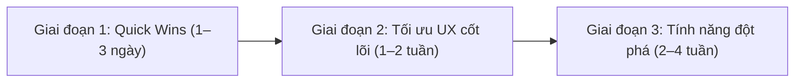

# Báo cáo Đánh giá Giao diện (UI/UX) & Tư vấn Phát triển Tính năng — EduChain Kids

> **Phạm vi rà soát:** Toàn bộ hệ thống giao diện người dùng (`src/app/**`, `src/components/**`, `src/app/globals.css`) trên cả 4 phân hệ vai trò (**Học sinh**, **Phụ huynh**, **Giáo viên**, **Quản trị viên**) và các studio chuyên biệt (**Làm bài**, **English Journey**, **Game trí tuệ**, **Đấu cờ**, **Luyện chữ đẹp**, **Bài giảng 3D / Thao giảng**, **Phòng triển lãm**).

---

## Phần 1. Tổng quan Điểm mạnh & Bản sắc Giao diện hiện tại

Dự án đã xây dựng được một ngôn ngữ thiết kế có cá tính rất rõ ràng, phù hợp với lứa tuổi tiểu học (Lớp 1–5) tại Việt Nam:

1. **Ý tưởng chủ đạo gần gũi ("Vở ô li tiểu học" & Cú Xanh Milo):**
   - Sử dụng hình ảnh trang vở kẻ ô li, lề đỏ, nhãn vở theo môn (`src/app/page.tsx`) kết hợp phông chữ **Quicksand** (`src/app/layout.tsx`) nét tròn, dễ đọc tiếng Việt có dấu.
   - Hệ thống linh vật **Milo** đa biểu cảm (`MiloMascot`, `MiloTrail`) và bộ biểu tượng **Fluent Emoji 3D** tạo cảm giác sinh động mà không bị rối mắt.
2. **Xử lý Chế độ Sáng / Tối (Light / Dark Mode) tinh tế:**
   - Có script chống nháy màu (FOUC) ngay trong `<head>` (`src/app/layout.tsx:28`).
   - Đặc biệt có cơ chế **"Đảo sáng" (`.light-island`, `.figure`)** trong `src/app/globals.css:857`: giữ nền giấy sáng cho các hình minh họa toán học (que tính, đồng hồ, hình học) ngay cả khi bật chế độ tối, đảm bảo độ tương phản chuẩn xác cho học sinh nhìn hình.
3. **Không gian làm việc của Giáo viên (`TeacherShell`) hiện đại:**
   - Thanh bên thu gọn được (`is-mini`), menu xổ ngang khi rê chuột (`tsh-fly`), dải tab công cụ theo ngữ cảnh nhóm (`tsh-gtabs`), thanh điều hướng đáy cho di động (`tsh-tabs`) và **Command Palette (`Ctrl + K`)** hỗ trợ tìm học sinh không dấu (`fold()`).
4. **Tối ưu hiệu năng khi làm bài (`src/app/lam-bai/page.tsx`):**
   - Đồng hồ đếm ngược dùng `useRef` và chỉ cập nhật `state` mỗi khi đổi số giây hiển thị (~1 lần/giây), tự động tạm dừng khi học sinh bấm *"Nghe đọc đề"* hoặc chuyển tab; tôn trọng cài đặt `prefers-reduced-motion`.

---

## Phần 2. Các vấn đề UI/UX cần chỉnh sửa (Phân loại theo mức độ ưu tiên)

### 2.1. Ưu tiên Cao (Lỗi hiển thị, Điều hướng & Kiến trúc Layout)

| # | Vấn đề phát hiện | Vị trí trong code | Chi tiết & Đề xuất chỉnh sửa |
|---|---|---|---|
| **1** | **Lỗi ký tự hiển thị / đọc màn hình (Mojibake)** | `src/components/english/EnglishStudio.tsx:116` | Thuộc tính `
` bị lỗi mã hóa ký tự tiếng Việt. **Cần sửa thành:** `aria-label="Câu của em"`. |
| **2** | **Thanh điều hướng chính (`MainNavigation`) vượt quá 5 ô & thiếu đồng nhất ngôn ngữ** | `src/components/navigation/MainNavigation.tsx:18-25` | Comment thiết kế ghi *"thanh 5 ô"* nhưng mảng `NAV_ITEMS` hiện có **6 mục** (`Học tập`, `English Journey`, `Game trí tuệ`, `Đấu cờ`, `Thành tích`, `Phụ huynh`). • Trên màn hình mobile nhỏ (320px–375px), 6 tab ngang rất chật. • Mục `English Journey` (rút gọn `English`) là tiếng Anh duy nhất giữa 5 mục tiếng Việt. • Tab `Phụ huynh` nằm cố định trên thanh học tập của bé khiến học sinh dễ bấm nhầm. **Đề xuất:** Đưa lối vào `Phụ huynh` về menu tài khoản (`AccountLink`) hoặc góc Header; giữ thanh chính đúng **5 tab** dành riêng cho việc học & vui chơi của học sinh; Việt hóa hoặc thêm phụ đề đồng nhất cho tab Tiếng Anh (*"Tiếng Anh PX"* / *"Giao tiếp"*). |
| **3** | **Render dư thừa `<LearnHeader />` bên trong `TeacherShell`** | `src/app/giao-vien/lop/[id]/**/page.tsx` (hơn 20 file) & `src/app/globals.css:4362` | `TeacherLayout` (`src/app/giao-vien/layout.tsx`) đã bọc toàn bộ trang của giáo viên trong `TeacherShell`, nhưng hơn 20 trang con trong `/giao-vien/lop/[id]/*` vẫn gọi `<LearnHeader />` rồi dùng CSS `.tsh .learn-top { display: none; }` để giấu đi. **Hệ quả:** Trình duyệt vẫn phải tạo DOM của `LearnHeader`, chạy `ResizeObserver` (`HeaderOffset`) và tạo kết nối lắng nghe `supabase.auth.onAuthStateChange` (`AccountLink`) ẩn phía dưới. **Đề xuất:** Bỏ `<LearnHeader />` ở nhánh render đã xác thực của các trang nằm trong `/giao-vien/lop/[id]/**` (chỉ giữ ở nhánh `not_configured` khi `TeacherLayout` không bọc `TeacherShell`). |
| **4** | **Trải nghiệm Đăng nhập & Chuyển đổi vai trò của Phụ huynh còn gây bối rối** | `src/app/dang-nhap/page.tsx:343-354` & `src/app/phu-huynh/page.tsx` | Hiện tại phụ huynh đối mặt với **3 cách truy cập khác nhau**: 1. Nhập *Mã lớp + PIN của con* (thực chất đăng nhập vào phiên `student` rồi điều hướng sang `/phu-huynh`). 2. Bấm *"Đăng nhập bằng email"* (nhảy sang tab *Thầy cô* `adult`). 3. Nhập *Mã mời phụ huynh* (`RedeemInviteForm`). **Hệ quả UX:** Khi phụ huynh đăng nhập bằng PIN của con, toàn trình duyệt mang session của học sinh. Nếu phụ huynh bấm về Trang chủ, họ thấy giao diện của con mà không biết làm sao quay lại trang Phụ huynh. **Đề xuất:** • Đổi tên tab `Thầy cô` thành `Email (Thầy cô / Phụ huynh)` hoặc tách rõ 2 lựa chọn trong tab Phụ huynh (*"Con học ở trường (Mã lớp + PIN)"* vs *"Tài khoản Gia đình (Email)"*). • Trên `/hoc-sinh`, thêm nút nhỏ *"👨‍👩‍👧 Góc Phụ huynh"* (có thể kèm cổng xác nhận đơn giản như phép nhân hoặc nhập lại PIN) và ngược lại trên `/phu-huynh` có nút *"🎒 Chuyển sang góc học của con"*. |

---

### 2.2. Ưu tiên Trung bình (Trải nghiệm tương tác & Thẩm mỹ)

1. **Màn hình chuẩn bị vào bài (`phase === 'intro'` tại `src/app/lam-bai/page.tsx:520-621`) quá nhiều chữ với học sinh Lớp 1–2:**
   - **Hiện trạng:** Trước khi vào câu hỏi số 1, học sinh phải đi qua: Thẻ kiến thức (`KnowledgeCard`), Khung chọn mức độ Cơ bản/Khá/Giỏi + nút đổi bộ câu (`set-panel`), Cài đặt âm thanh đồng hồ (`timer-sound`), Thống kê bài (`intro-facts`), Dải cấp độ L1–L5 (`level-strip`), và 5 quy tắc dài (`intro-rules`). Nút quan trọng nhất là **"Bắt đầu làm bài"** nằm ở cuối cùng (`line 608`).
   - **Đề xuất chỉnh sửa:**
     - Đưa nút **"▶ Bắt đầu làm bài"** lên ngay dưới tiêu đề và thẻ tóm tắt ngắn (trên màn hình đầu tiên - *above the fold*).
     - Gom phần *Chọn mức độ*, *Âm thanh đồng hồ* và *5 quy tắc* vào một khung thu gọn `
` hoặc nút **"⚙️ Tuỳ chỉnh mức độ & Âm thanh"** để giao diện thoáng, giúp học sinh lớp 1–2 vào bài chỉ với 1 chạm.

2. **Tự động chuyển câu quá nhanh khi học sinh trả lời sai (`src/app/lam-bai/page.tsx:60, 416-429`):**
   - **Hiện trạng:** `ADVANCE_MS = { correct: 1800, wrong: 4500, timeout: 4500 }`. Khi làm sai, học sinh chỉ có 4,5 giây để nhận ra mình sai và kịp bấm nút *"Xem lời giải"* (`setHoldAdvance(true)`). Với tốc độ đọc của học sinh tiểu học (đặc biệt Lớp 1–3), 4,5 giây là quá ngắn, dẫn đến việc bé bị đẩy sang câu tiếp theo mà chưa hiểu vì sao mình sai.
   - **Đề xuất chỉnh sửa:**
     - Khi trả lời **Đúng**: Giữ tự động chuyển câu sau `1.8s` (tạo nhịp độ hứng khởi).
     - Khi trả lời **Sai** hoặc **Hết giờ**: **Không tự động đếm ngược chuyển câu** (hoặc tăng lên 10–12 giây), đồng thời tự động mở sẵn phần giải thích ngắn (`explanation`) và hiển thị nút to rõ **"Đã hiểu · Câu tiếp theo →"**.

3. **Thanh công cụ dưới đáy khi làm bài (`feedback-bar` tại `src/app/lam-bai/page.tsx:800+`) và vùng đệm cuộn (`paddingBottom: 240`):**
   - **Hiện trạng:** Trang làm bài vừa có thanh HUD trên đầu (`quiz-bar` + `quiz-nav`), vừa có dải `MiloTrail`, công cụ `Nghe đọc đề / Đổi câu`, nội dung câu hỏi, hình minh họa, và thanh `feedback-bar` cố định dưới đáy. Trên màn hình laptop 13 inch (chiều cao viewport ~650px–720px) hoặc điện thoại nằm ngang, vùng hiển thị câu hỏi bị ép hẹp.
   - **Đề xuất chỉnh sửa:** Gộp dải chấm câu hỏi (`quiz-nav`) và `MiloTrail` làm một thanh tiến độ tương tác duy nhất (vừa có Milo bước đi trên từng chấm câu hỏi, vừa bấm chọn câu được) để tiết kiệm ~60px chiều cao màn hình.

4. **Hỗ trợ thiết bị di động cho các Studio phức tạp của Giáo viên (`DeckStudio`, `Lesson3DStudio`, `Whiteboard`, `GroupsSeating`):**
   - **Hiện trạng:** Các công cụ kéo-thả như Trình soạn bài giảng kiểu Canva (`src/components/deck/DeckStudio.tsx`), Mô hình 3D (`src/components/lesson3d/Lesson3DStudio.tsx`), và Bảng trắng (`src/components/board/Whiteboard.tsx`) được thiết kế tối ưu cho màn hình lớn. Khi giáo viên mở trên điện thoại dọc, không gian thao tác bị bó hẹp.
   - **Đề xuất chỉnh sửa:** Thêm banner gợi ý xoay ngang màn hình (*"📱 Xoay ngang điện thoại hoặc mở trên máy tính để kéo thả dễ hơn"*) hoặc chế độ **"Xem nhanh / Trình chiếu gọn"** trên điện thoại để giáo viên vẫn đọc lại được slide trước giờ lên lớp.

5. **Trạng thái tải trang (`Suspense` & Skeleton Loading):**
   - **Hiện trạng:** Nhiều trang Client Component (`src/app/chon-bai/page.tsx:315`, `src/app/lam-bai/page.tsx`, `src/app/ket-qua/page.tsx:265`, `src/app/dang-nhap/page.tsx:365`) đang dùng `<Suspense fallback={null}>`, dẫn đến khoảng trắng ngắn hoặc nhảy bố cục (CLS) khi hydrate. Ngoài ra, `src/app/loading.tsx` và `src/app/giao-vien/loading.tsx` đang trùng lặp hoàn toàn.
   - **Đề xuất chỉnh sửa:** Tạo component `<NotebookSkeleton />` mang phong cách trang vở kẻ ô kèm hiệu ứng shimmer nhẹ để dùng chung cho các `Suspense fallback`.

6. **Tối ưu kiến trúc file CSS đơn lẻ (`src/app/globals.css` — 8.227 dòng):**
   - **Hiện trạng:** Mọi quy tắc CSS của toàn dự án nằm chung trong 1 file `globals.css` (8.227 dòng). Học sinh vào trang chủ hoặc làm bài cũng phải tải toàn bộ CSS của trình soạn slide (`dk-`, `cv-`), cờ vua/cờ tướng, bảng trắng và trang quản trị (`adm-`).
   - **Đề xuất chỉnh sửa:** Tách `globals.css` thành các file CSS theo phân hệ và import tại từng `layout.tsx` tương ứng:
     - `src/styles/base.css` (Design tokens, reset, header/footer, nút bấm chung)
     - `src/styles/learn.css` (Trang chủ, Chọn bài `cb-`, Làm bài `qz-`, Kết quả)
     - `src/styles/teacher.css` (Import trong `src/app/giao-vien/layout.tsx`: `tsh-`, `tdy-`, `dk-`, `cv-`, `td-`)
     - `src/styles/admin.css` (Import trong `src/app/quan-tri/layout.tsx`: `adm-`)

---

## Phần 3. Tư vấn Bổ sung các Chức năng Mới (Product & Feature Roadmap)

Dựa trên nền tảng dữ liệu và các module đã có sẵn trong codebase, dưới đây là các tính năng có tính khả thi cao và mang lại giá trị lớn nhất cho từng nhóm người dùng:

### 3.1. Nhóm tính năng cho Học sinh (Tăng hứng thú & Cá nhân hóa học tập)

#### 1. "Giỏ Câu Hay Sai" & Ôn tập ngắt quãng (Smart Mistake Notebook)
- **Lý do:** Hiện tại trang `/hoc-sinh` (`src/app/hoc-sinh/page.tsx:63-66`) mới chỉ gợi ý làm lại cả bài học nếu tỉ lệ đúng `< 80%`. Học sinh thường ngại làm lại cả bài 10 câu khi chỉ sai 2–3 câu.
- **Cách hoạt động:**
  - Tự động trích xuất các câu học sinh trả lời `wrong` hoặc `timeout` từ lịch sử làm bài.
  - Tạo nút **"🎒 Túi câu cần phục thù cùng Milo (5 câu)"** ngay tại trang `/hoc-sinh`.
  - Khi học sinh làm đúng lại một câu từng sai 2 lần liên tiếp, câu đó được "tốt nghiệp" khỏi giỏ và thưởng thêm Sao.

#### 2. Chế độ "Lớp 1 Thân Thiện" (Audio-First & Visual Mode cho Lớp 1)
- **Lý do:** Học sinh Lớp 1 (đặc biệt ở Học kỳ 1) chưa đọc thông viết thạo chữ dài, việc phải tự tìm nút *"Nghe đọc đề"* ở mỗi câu gây cản trở.
- **Cách hoạt động:**
  - Khi `grade === 1`, tự động bật chế độ **Tự động đọc câu hỏi** ngay khi chuyển sang câu mới (có nút bật/tắt trên thanh HUD).
  - Bổ sung biểu tượng loa nhỏ bên cạnh từng đáp án trắc nghiệm dài để bé chạm vào nghe đọc nội dung từng đáp án.

#### 3. Góc Nuôi dưỡng Cú Xanh Milo & Đổi Quà bằng Sao (Milo Companion & Star Shop)
- **Lý do:** Học sinh hiện tích lũy được rất nhiều Điểm/Sao và xem `GiftShelf` (`src/components/achievements/GiftShelf.tsx`) hay `StickerAlbum`, nhưng điểm số mới dừng ở việc xếp hạng danh hiệu (`rankFor`).
- **Cách hoạt động:**
  - Cho phép học sinh dùng Sao/Điểm tích lũy để đổi phụ kiện trang trí cho linh vật Milo (kính cận, mũ trạng nguyên, khăn quàng đỏ, áo phi hành gia...) hoặc đổi phông nền góc học tập.
  - Phụ kiện đã chọn của Milo sẽ xuất hiện xuyên suốt trên `MiloTrail` khi làm bài và trên bảng xếp hạng lớp.

#### 4. Đồng bộ tiến độ `English Journey` & `Luyện chữ` lên tài khoản Học sinh
- **Lý do:** Hiện tại `EnglishStudio` (`localStorage: educhain-english-progress-v1`) và `ShadowingStudio` chỉ lưu kết quả trên trình duyệt cục bộ. Khi học sinh đổi thiết bị hoặc khi giáo viên/phụ huynh mở báo cáo, họ không thấy con đã luyện phát âm tiếng Anh hay đã tô chữ được bao nhiêu bài.
- **Cách hoạt động:** Bổ sung API đồng bộ nhẹ (tương tự `/api/tien-do/game`) để ghi nhận số chủ đề English Journey đã hoàn thành và điểm phát âm Shadowing vào hồ sơ học sinh, hiển thị trên cả `/hoc-sinh` và `/phu-huynh`.

---

### 3.2. Nhóm tính năng cho Giáo viên (Giảm tải công việc & Tăng tương tác lớp học)

#### 5. Chế độ "Đấu Trường Lớp Học" trên màn chiếu (Live Classroom Quiz Show)
- **Lý do:** Giáo viên đã có công cụ `Gọi tên – Dò bài` (`/goi-ten`), `Thi đua tổ` (`/thi-dua`) và `Trình chiếu thao giảng` (`DeckPlayer`), nhưng các công cụ này đang tách rời.
- **Cách hoạt động:**
  - Cho phép giáo viên mở bất kỳ bài học nào ở chế độ **"Chiếu câu hỏi thi đua tổ"** trên TV/Máy chiếu lớp học.
  - Màn hình hiện câu hỏi chữ to + đồng hồ đếm ngược + nút cộng điểm nhanh cho `Tổ 1, Tổ 2, Tổ 3, Tổ 4` ngay trên màn hình câu hỏi. Điểm cộng tự động lưu thẳng vào bảng **Thi đua tổ** của tuần đó.

#### 6. Giao bài bù lỗ hổng 1 chạm (One-Click Remedial Assignment)
- **Lý do:** Trang `/giao-vien/lop/[id]/lo-hong` (`GapsView.tsx`) đã thống kê rất tốt những bài/dạng toán mà lớp hay làm sai và liệt kê danh sách các em làm sai, nhưng giáo viên vẫn phải sang trang `/giao-bai` để tạo bài giao thủ công.
- **Cách hoạt động:**
  - Ngay tại mỗi dòng "Lỗ hổng kiến thức", thêm nút **"🎯 Giao bài ôn lại cho X em này"**.
  - Khi bấm, hệ thống tự động tạo một `assignment` chỉ nhắm tới danh sách `student_ids` đang yếu bài đó (`assignment_targets`), giúp dạy học phân hóa (differentiated instruction) chỉ trong 5 giây.

#### 7. Nâng cấp Trợ lý AI (`AiAssistant`) gắn sâu vào quy trình soạn giảng
- **Lý do:** Dự án đã có sẵn hạ tầng AI BYOK mã hóa AES-256-GCM rất an toàn (`src/app/api/ai/chat/route.ts`, `src/app/api/ai/questions/route.ts`), nhưng hiện tại `AiAssistant` mới chủ yếu là khung chat hỏi đáp tự do ở góc màn hình.
- **Cách hoạt động:**
  - **Soạn Slide Thao giảng từ Giáo án bằng AI:** Trong `DeckStudio`, thêm nút *"✨ AI tạo dàn ý 5 slide từ bài học"* để sinh sẵn tiêu đề, câu hỏi khởi động và hình 3D gợi ý.
  - **AI Gợi ý Nhận xét cá nhân hóa theo Thông tư 27:** Trong trang `/nhan-xet`, kết hợp dữ liệu `Sổ lớp` (chuyên cần, khen/nhắc) + `Điểm luyện tập` + AI để sinh lời nhận xét tự nhiên, không bị trùng lặp văn mẫu giữa 40 học sinh trong lớp.

#### 8. Hoàn thiện luồng Cấp & Xác thực Chứng nhận (`Certificates`)
- **Lý do:** Cơ sở dữ liệu đã tạo sẵn bảng `certificates` và RLS policies từ migration `0001_platform_foundation.sql`, đồng thời thư viện xuất PDF/QR (`src/lib/praise/pdf.ts`, `src/lib/qr.ts`) đã có sẵn, nhưng chưa được nối thành tính năng hoàn chỉnh.
- **Cách hoạt động:**
  - Cho phép Giáo viên (hoặc hệ thống tự động cuối học kỳ) cấp **"Giấy Chứng nhận Hoàn thành Chuyên đề / Ngôi sao Chăm học"** kèm mã QR xác minh tại đường dẫn công khai `/chung-nhan/[code]`.

---

### 3.3. Nhóm tính năng cho Phụ huynh (Đồng hành hiệu quả, không áp lực)

#### 9. Nút "Gửi Lời Động Viên cho Con" (Parent Cheer Sticker)
- **Lý do:** Trang `/phu-huynh` hiện tại cho phép phụ huynh xem điểm, xem sổ lớp và nhắn tin với cô giáo (`ParentMessages`), nhưng chưa có kênh tương tác cảm xúc trực tiếp giữa **Bố mẹ ↔ Con** ngay trong ứng dụng.
- **Cách hoạt động:**
  - Khi phụ huynh thấy con vừa làm xong bài hoặc được cô khen trên `/phu-huynh`, phụ huynh bấm nút **"❤️ Gửi lời khen cho con"** (chọn nhãn dán + lời nhắn ngắn như *"Bố mẹ tự hào về con lắm!"*).
  - Lần tới con mở `/hoc-sinh` hoặc `/ket-qua`, Cú Milo sẽ nhảy ra trao tấm thiệp của bố mẹ cho bé.

#### 10. Cài đặt "Học trước – Chơi sau" (Smart Playtime Gate)
- **Lý do:** Nhiều phụ huynh lo lắng con mở ứng dụng chỉ để vào mục `Game trí tuệ` (`/tro-choi`) hoặc `Đấu cờ` (`/co`) mà quên làm bài tập cô giao.
- **Cách hoạt động:**
  - Trong khu vực Phụ huynh (`FamilyPanel` hoặc cài đặt của phụ huynh), thêm tùy chọn bật **"Chế độ Học trước – Chơi sau"**:
  - Học sinh chỉ cần hoàn thành **1 bài học (hoặc 1 bài cô giao)** trong ngày là tự động mở khóa khu vực *Game trí tuệ* và *Đấu cờ* trong 30 phút. Giúp tạo thói quen tự giác mà bố mẹ không cần nhắc nhở.

#### 11. Thẻ Tóm tắt Tuần (Weekly Snapshot) gửi Zalo 1 chạm
- **Lý do:** Phụ huynh Việt Nam sử dụng Zalo hằng ngày (dự án cũng đã có tích hợp link nhóm Zalo lớp `ZaloGroupLink.tsx`).
- **Cách hoạt động:**
  - Cuối mỗi tuần, hệ thống tổng hợp một thẻ ảnh PNG gọn đẹp (tương tự cơ chế render canvas của `PraiseLetters`): Số ngày đi học, số bài đã làm, số sao đạt được, 1 môn tiến bộ nhất và 1 mục cần cố gắng.
  - Giáo viên hoặc phụ huynh có thể tải/chia sẻ nhanh qua Zalo chỉ bằng 1 nút bấm.

---

## Phần 4. Lộ trình Triển khai Đề xuất (Action Plan)

### Giai đoạn 1: Chỉnh sửa nhanh (Quick Wins — 1 đến 3 ngày)
- [ ] Sửa lỗi ký tự `aria-label="Câu của em"` trong `src/components/english/EnglishStudio.tsx:116`.
- [ ] Tinh chỉnh `MainNavigation.tsx` về đúng 5 tab học sinh, chuyển mục `Phụ huynh` lên cụm công cụ tài khoản/header.
- [ ] Gỡ bỏ `<LearnHeader />` dư thừa trong các trang con của `/giao-vien/lop/[id]/**` đã được bọc bởi `TeacherShell`.
- [ ] Đưa nút **"Bắt đầu làm bài"** lên đầu màn hình `intro` trong `src/app/lam-bai/page.tsx` và tắt tự động chuyển câu nhanh khi học sinh trả lời sai.

### Giai đoạn 2: Nâng cấp UX & Đồng bộ dữ liệu (1 đến 2 tuần)
- [ ] Làm rõ luồng đăng nhập Phụ huynh trên `/dang-nhap` và thêm nút chuyển đổi nhanh Học sinh ↔ Phụ huynh.
- [ ] Đồng bộ tiến độ `English Journey` và `Luyện chữ` lên Supabase để hiển thị trong báo cáo của Giáo viên & Phụ huynh.
- [ ] Bổ sung nút **"Giao bài ôn lại cho nhóm học sinh này"** ngay tại trang `Lỗ hổng kiến thức` (`/lo-hong`).
- [ ] Tách dần `src/app/globals.css` theo từng nhóm route layout (`learn`, `teacher`, `admin`) để giảm dung lượng CSS tải lần đầu.

### Giai đoạn 3: Tính năng tạo lợi thế cạnh tranh (2 đến 4 tuần)
- [ ] Xây dựng **"Giỏ câu hay sai (Ôn tập cùng Milo)"** và **Chế độ Audio-First cho Lớp 1**.
- [ ] Ra mắt tính năng **"Gửi lời động viên của Bố mẹ"** & **"Chế độ Học trước – Chơi sau"** cho Phụ huynh.
- [ ] Tích hợp **"Đấu trường lớp học trực tiếp"** (kết nối Câu hỏi bài học + Thi đua tổ trên màn chiếu) và hoàn thiện luồng cấp **Chứng nhận (`Certificates`)** có QR xác thực.
